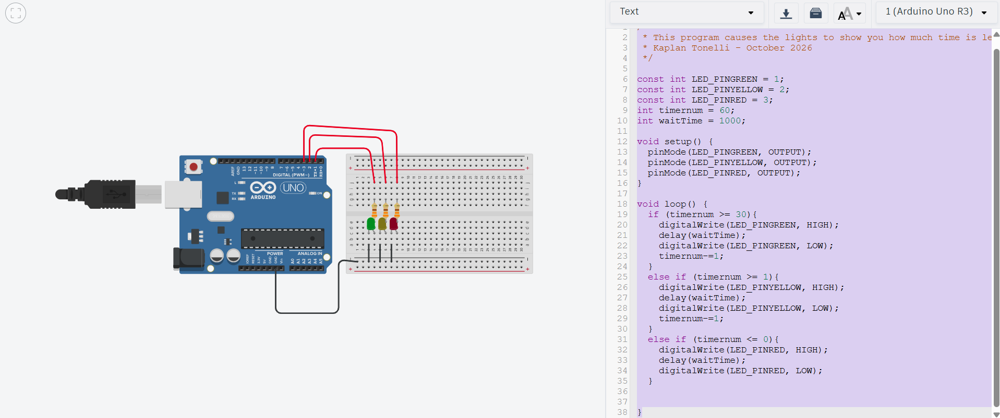

# Signals and Systems

> ** Remove the instructions in block quotes before you submit **

> Design, build, program, and test a signaling system that communicates useful information without a screen or speaker. The red, yellow, and green LEDs 
> automatically cycle through your planned states; no push button is needed. Complete this README as you work. Keep your planning, testing evidence, and 
> link to your video demo here.

## 1. System purpose

- **Problem and real-world context:** I cant tell how much time something has left
- **Intended user:** People who want to know the time of something from far away
- **What information should your signals communicate?** getting close to being done, times up, and still lots of time left
- **How does the user interpret and use that information?** If its yellow is 49% or less, green is 50% or more, and red is 0%

## 2. State table and pattern plan

> Use the launch activity's approach: interpret a pattern, identify its states, and explain its meaning. Plan at least three meaningful message states. A 
> message may use several rows, such as a blinking pattern.

> Record a new row whenever any LED changes. Use ON/OFF and durations in milliseconds (1,000 ms = 1 second). Add or remove rows as needed. The last row 
> returns to the first automatically.

| Step | State/message name | LED Color | LED Color | LED Color | Duration (ms) | Meaning to the user |
| --- | --- | --- | --- | --- | --- | --- |
| 1 | Over 50% | green | green | green | 15 secs | timers over halfway |
| 2 | under 50% | yellow | yellow | yellow | 15 secs | timers halfway |
| 3 | 0% | red | red | red | forever | timers up |

**Sequence:** Green → yellow → red → repeat  

## 3. Circuit design3
3

> Design your layout in TinkerCAD.
> Export an image and upload it to this repo. Link it below

### Ohm's law calculations

> Use `R = (V_output - V_LED) / I` to estimate the resistance for each LED. Use volts, amperes, and ohms; convert milliamperes to amperes. 
> . Choose a suitable available resistor and check the resulting current using `I = (V_output - V_LED) / R`.

| LED | Arduino output voltage (V) | LED voltage drop (V) | Calculated resistor voltage (V) | Target current (A) | Calculated resistance (Ω) | Chosen resistance (Ω) | Estimated actual current (A) |
| --- | --- | --- | --- | --- | --- | --- | --- |
| Green LED | 5.0 | 3V | 2V | 15mA | 133Ω | 230Ω | 8mA |
| Yellow LED | 5.0 | 2V | 3V | 15mA | 200Ω | 230Ω | 13mA |
| Red LED | 5.0 | 2V | 3V | 10mA | 300Ω | 330Ω | 9mA |

## 4. Testing and revision
> Test your system with two people outside our class. Show each person the complete sequence before explaining its intended meaning. Ask:
> What do you think this system is communicating? Describe what each light pattern means to you.
> Were any patterns confusing or difficult to tell apart? Explain which ones and why.
> What would make the signals easier to understand? Consider the colors, combinations, blinking, or timing.

**Person 1:** Person 1Said that it was a timer but it took a little bit for them to understand, he said that I should make it more visually appealing.

**Person 2:** Person 2 couldn't tell what it was but realized after I told them, they said I should make the timer faster because it takes too long

**Did their interpretations match your intended meaning? Explain:** Yes, mostly

**Revisions made to the system based on feedback**
> Based on person 2's feedback I made it faster so its easier to understand

**Revision and reason**: Timer is faster

**Result after testing the revision:** It now is a faster timer

## 5. Video Demonstration
> Replace the placeholder below with a link to your video. Demonstrate the complete repeating sequence and explain what each signal communicates. Make sure 
> your instructor can access the video.

[Video demonstration](https://www.youtube.com/watch?v=E91wwh8d3MU&feature=youtu.be)